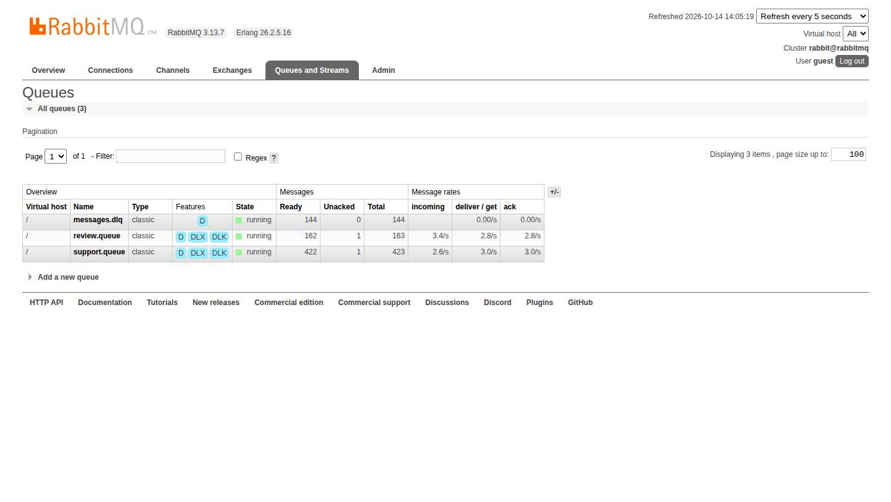
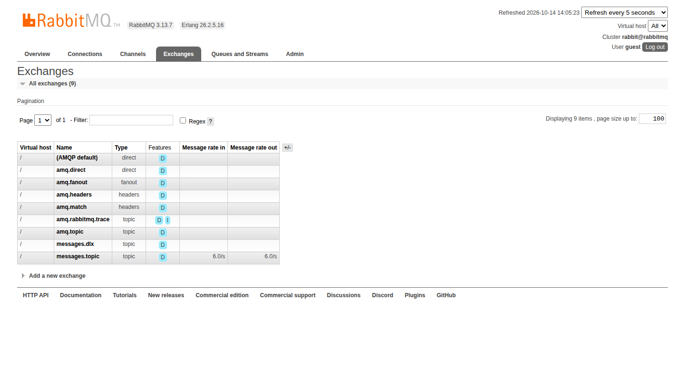
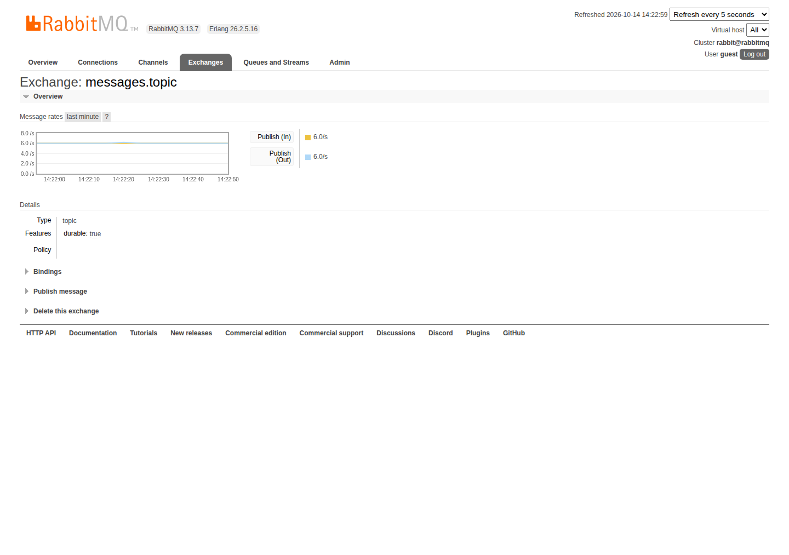
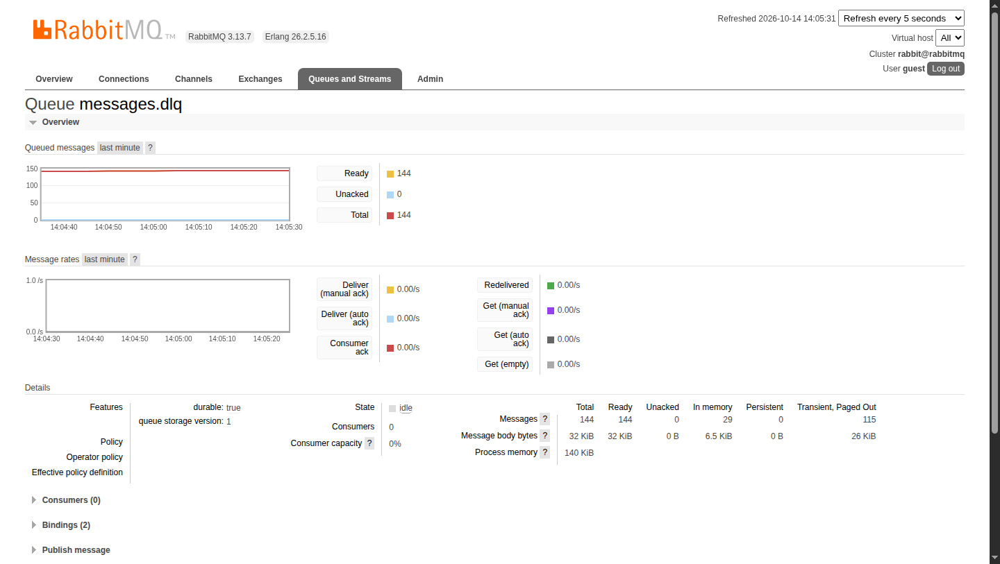

# Atividade 5 – Sistema Distribuído de Classificação Inteligente de Mensagens com RabbitMQ

Este repositório contém a implementação completa de um sistema distribuído composto por 4 containers Docker, desenvolvido em **Java 17**, **RabbitMQ (Topic Exchange & Dead Letter Queue)** e **Inteligência Artificial embarcada (Smile Machine Learning)**.

---

## 🏗️ 1. Arquitetura da Solução

O sistema é composto por 4 containers interconectados na mesma rede Docker bridge (`mq-network`):

```mermaid
flowchart TD
    subgraph Docker Network [Docker Compose Network]
        P[Gerador de Mensagens\n(Producer - >= 5 msg/s)]
        
        subgraph RabbitMQ [RabbitMQ Message Broker]
            TE[Topic Exchange\n'messages.topic']
            DLX[Dead Letter Exchange\n'messages.dlx']
            
            Q_REV[Fila 'review.queue'\n(x-dead-letter-exchange)]
            Q_SUP[Fila 'support.queue'\n(x-dead-letter-exchange)]
            Q_DLQ[Fila 'messages.dlq']
        end
        
        C1[Consumidor 1\nAnálise de Sentimento\n(Smile Naive Bayes)]
        C2[Consumidor 2\nClassificação de Suporte\n(Smile Naive Bayes)]
    end

    P -->|routing key: review.product| TE
    P -->|routing key: support.request| TE
    
    TE -->|review.*| Q_REV
    TE -->|support.*| Q_SUP
    
    Q_REV -->|manual ACK / delay| C1
    Q_SUP -->|manual ACK / delay| C2
    
    C1 -.->|basicNack requeue=false| DLX
    C2 -.->|basicNack requeue=false| DLX
    
    DLX -->|routing key: messages.dlq| Q_DLQ
```

### Componentes:
1. **`rabbitmq`**: Broker de mensagens RabbitMQ 3.13 com o plugin de gerenciamento Web habilitado na porta `15672` e porta AMQP `5672`.
2. **`producer-service` (Gerador de Mensagens)**:
   - Gera continuamente mensagens em uma taxa configurável $\ge 5\text{ msgs/s}$ (padrão: 6 msgs/s).
   - Alterna entre mensagens de **Avaliação de Produtos** e **Solicitações de Suporte**.
   - Publica no Topic Exchange `messages.topic` com as routing keys `review.product` e `support.request`.
   - Injeta periodicamente mensagens com simulação de erro para demonstração da Dead Letter Queue (DLQ).
3. **`consumer-sentiment-service` (Consumidor 1 - Análise de Sentimento)**:
   - Consome da fila `review.queue`.
   - Utiliza uma IA embarcada baseada na biblioteca **Smile (DiscreteNaiveBayes - Multinomial)** treinada em português.
   - Classifica em: `POSITIVA`, `NEGATIVA` ou `NEUTRA`, exibindo a probabilidade/confiança.
   - Implementa confirmação manual de consumo (**Manual ACK**).
   - Processa intencionalmente mais lento (~350ms por mensagem) para permitir a visualização do crescimento da fila no RabbitMQ.
   - Encaminha mensagens com falha/erro para a DLQ via `basicNack(requeue=false)`.
4. **`consumer-support-service` (Consumidor 2 - Classificação de Suporte)**:
   - Consome da fila `support.queue`.
   - Utiliza uma IA embarcada baseada na biblioteca **Smile (DiscreteNaiveBayes - Multinomial)** treinada em português.
   - Classifica em: `Problema de acesso`, `Problema de desempenho` ou `Problema de conexão`.
   - Implementa **Manual ACK**, delay configurável e encaminhamento automático para a DLQ em caso de rejeição.

---

## 🤖 2. Inteligência Artificial Embarcada (Smile)

Cada consumidor carrega seu próprio modelo de Processamento de Linguagem Natural (NLP) e Machine Learning embarcado, sem dependência de serviços externos ou Python:

- **Biblioteca**: `com.github.haifengl:smile-core:3.0.2` e `com.github.haifengl:smile-nlp:3.0.2`.
- **Algoritmo**: `smile.classification.DiscreteNaiveBayes` com modelo `MULTINOMIAL`.
- **Pipeline de NLP (`TextVectorizer`)**:
  1. **Normalização Unicode**: Conversão para minúsculas e remoção de caracteres diacríticos/acentos via decomposição NFD (`ç` $\to$ `c`, `é` $\to$ `e`, `ã` $\to$ `a`).
  2. **Sanitização**: Remoção de caracteres de pontuação e numerais.
  3. **Remoção de Stopwords**: Filtragem de mais de 70 stopwords da língua portuguesa (`de`, `a`, `o`, `para`, `com`, etc.).
  4. **Bag-of-Words & Vetorização**: Mapeamento do vocabulário único em índices numéricos e transformação de cada texto em vetores de frequência de termos.
- **Treinamento e Inferência**:
  - Na inicialização de cada consumidor, a IA é treinada com datasets curados em português contendo exemplos representativos de cada domínio.
  - Para cada mensagem recebida, a IA calcula a distribuição a posteriori de probabilidades para todas as classes e seleciona a de maior confiança:
    $$\hat{c} = \arg\max_{c \in C} P(c) \prod_{i=1}^{V} P(w_i \mid c)^{x_i}$$

---

## ⚙️ 3. Regras Técnicas Atendidas

| Requisito | Como foi implementado |
|---|---|
| **4 Containers Docker** | `docker-compose.yml` orquestrando RabbitMQ, Producer, Consumer Sentiment e Consumer Support. |
| **Topic Exchange** | Exchange `messages.topic` do tipo `topic` roteando por chaves `review.product` e `support.request`. |
| **Manual ACK** | Consumidores usam `channel.basicConsume(..., false, ...)` e invocam explicitamente `channel.basicAck(deliveryTag, false)` após o processamento. |
| **Taxa $\ge 5$ msgs/s** | Produtor configurado com taxa padrão de 6.0 msgs/s (intervalo de ~166ms). |
| **Crescimento de Filas** | Consumidores processam a ~350ms/msg (~2.8 msgs/s), menor que a taxa de chegada, gerando fila visível na UI. |
| **Dead Letter Queue (DLQ)** | Filas declaradas com `x-dead-letter-exchange` apontando para `messages.dlx`. Em caso de erro, é executado `basicNack(deliveryTag, false, false)`. |
| **Identificadores das Mensagens** | Cada mensagem contém UUID único, timestamp ISO-8601, tipo e conteúdo em JSON. |

---

## 🚀 4. Como Executar

### Pré-requisitos:
- Docker e Docker Compose instalados.

### Passo 1: Construir e Iniciar os Serviços
Execute no diretório raiz do projeto:
```bash
docker compose up --build -d
```

### Passo 2: Acompanhar os Logs dos Serviços
Para visualizar a geração e classificação de mensagens em tempo real no console:
```bash
# Todos os containers juntos:
docker compose logs -f

# Ou logs específicos de cada serviço:
docker compose logs -f producer
docker compose logs -f consumer-sentiment
docker compose logs -f consumer-support
```

### Passo 3: Acessar a Interface de Administração do RabbitMQ
Abra o navegador no endereço:
- **URL**: [http://localhost:15672](http://localhost:15672)
- **Usuário**: `guest`
- **Senha**: `guest`

Na interface, verifique:
- **Aba "Queues"**: Observe as filas `review.queue` e `support.queue` com mensagens prontas (*Ready*) crescendo continuamente e a fila `messages.dlq`.
- **Aba "Exchanges"**: Inspecione o `messages.topic` (com taxa de 6.0 msg/s) e seus bindings para cada fila.
- **Detalhes da DLQ (`messages.dlq`)**: Clique na fila, expanda a seção **Get messages** e clique em **Get Message(s)** para inspecionar a mensagem rejeitada e os cabeçalhos `x-death`.

### Passo 4: Finalizar a Execução
```bash
docker compose down
```

---

## 📸 5. Evidências de Execução

As evidências foram capturadas diretamente da execução do sistema em containers:

### 1. Visão Geral das Filas e Crescimento (`docs/evidencias/02_queues.png`)
Mostra as filas `messages.dlq`, `review.queue` e `support.queue`, com os argumentos `DLX` e `DLK` ativos, e as mensagens acumulando devido ao consumo com delay:



### 2. Topic Exchange e Taxas de Mensagens (`docs/evidencias/03_exchanges.png`)
Mostra a exchange `messages.topic` com taxa de 6.0 msgs/s e a exchange `messages.dlx`:



### 3. Associação das Routing Keys ao Topic Exchange (`docs/evidencias/05_exchange_topic_bindings.png`)
Mapeamento de `review.product` para `review.queue` e `support.request` para `support.queue`:



### 4. Inspeção da Dead Letter Queue (`docs/evidencias/04_dlq_details.png`)
Mensagens com falha armazenadas na fila DLQ aguardando auditoria:



### 5. Inspeção do Header `x-death` da Mensagem Morta
Exemplo de mensagem rejeitada capturada via API da DLQ:
```json
{
  "exchange": "messages.dlx",
  "routing_key": "messages.dlq",
  "properties": {
    "message_id": "ec235e19-08a9-4d7b-b094-df18b6092613",
    "headers": {
      "x-death": [
        {
          "count": 1,
          "exchange": "messages.topic",
          "queue": "support.queue",
          "reason": "rejected",
          "routing-keys": ["support.request"]
        }
      ]
    }
  },
  "payload": "{\"id\":\"ec235e19...\",\"type\":\"SUPPORT\",\"content\":\"⚠️ [TESTE_DLQ_ERRO_SIMULADO] Erro intencional para validação da Dead Letter Queue!\",\"simulateError\":true}"
}
```

---

## 🎬 6. Roteiro Sugerido para o Vídeo de Demonstração (~5 minutos)

| Tempo | Etapa | O que mostrar e falar |
|---|---|---|
| **00:00 - 00:45** | **Apresentação e Arquitetura** | Apresentar o projeto, explicar a arquitetura com 4 containers no `docker-compose.yml`, o Topic Exchange e os dois consumidores com IA Smile. |
| **00:45 - 01:45** | **Subida dos Containers e RabbitMQ UI** | Executar `docker compose up -d`. Abrir o navegador em `http://localhost:15672`. Mostrar as conexões ativas, exchanges (`messages.topic` e `messages.dlx`) e os bindings das routing keys. |
| **01:45 - 03:00** | **Geração e Classificação com IA** | Abrir o terminal com `docker compose logs -f`. Destacar a taxa $\ge 5\text{ msg/s}$ do produtor e as classificações em tempo real com porcentagem de confiança (positiva/negativa/neutra e acesso/desempenho/conexão). |
| **03:00 - 04:00** | **Crescimento das Filas** | Voltar à interface do RabbitMQ na aba *Queues*. Mostrar os contadores *Ready* e os gráficos subindo, comprovando que o produtor é mais rápido que os consumidores. |
| **04:00 - 05:00** | **Dead Letter Queue (DLQ)** | Mostrar no terminal a mensagem de teste de erro sendo rejeitada com `basicNack`. Ir na fila `messages.dlq` no RabbitMQ, clicar em *Get messages*, e exibir o payload e o cabeçalho `x-death` com `reason: rejected`. Concluir a apresentação. |

---

## 📁 Estrutura do Código-Fonte

```
trab5/
├── pom.xml                                   # POM pai multi-módulo
├── docker-compose.yml                        # Orquestração dos 4 containers
├── .gitignore                                # Arquivos ignorados pelo Git
├── README.md                                 # Documentação técnica e guia de execução
├── common/                                   # Modelos, DTOs, configurações AMQP e motor Smile NLP
│   ├── pom.xml
│   └── src/main/java/com/sd/trab5/common/
│       ├── model/MessagePayload.java         # DTO com UUID, timestamp, type, content
│       ├── model/MessageType.java            # Enum REVIEW / SUPPORT
│       ├── config/RabbitMQConfig.java        # Topologia, exchanges, filas e DLQ
│       └── ai/
│           ├── TextVectorizer.java           # Tokenizer, remoção de acentos e stopwords
│           ├── SmileClassifier.java          # Wrapper Smile DiscreteNaiveBayes Multinomial
│           └── TrainingData.java             # Datasets de treinamento em português
├── producer/                                 # Serviço Gerador de Mensagens
│   ├── Dockerfile
│   ├── pom.xml
│   └── src/main/java/com/sd/trab5/producer/
│       ├── MessageProducerApp.java           # Loop de publicação a >= 5 msgs/s
│       └── MessageGenerator.java             # Gerador de avaliações, suporte e erros
├── consumer-sentiment/                       # Consumidor 1: Análise de Sentimento
│   ├── Dockerfile
│   ├── pom.xml
│   └── src/main/java/com/sd/trab5/consumer/sentiment/
│       └── SentimentConsumerApp.java         # IA de sentimento, manual ACK e DLQ
├── consumer-support/                         # Consumidor 2: Classificação de Chamados
│   ├── Dockerfile
│   ├── pom.xml
│   └── src/main/java/com/sd/trab5/consumer/support/
│       └── SupportConsumerApp.java           # IA de suporte, manual ACK e DLQ
└── docs/
    └── evidencias/                           # Capturas da interface do RabbitMQ e logs
        ├── 01_overview.png
        ├── 02_queues.png
        ├── 03_exchanges.png
        ├── 04_dlq_details.png
        ├── 05_exchange_topic_bindings.png
        ├── 06_dlq_message_inspected.png
        └── execucao_logs.txt
```
